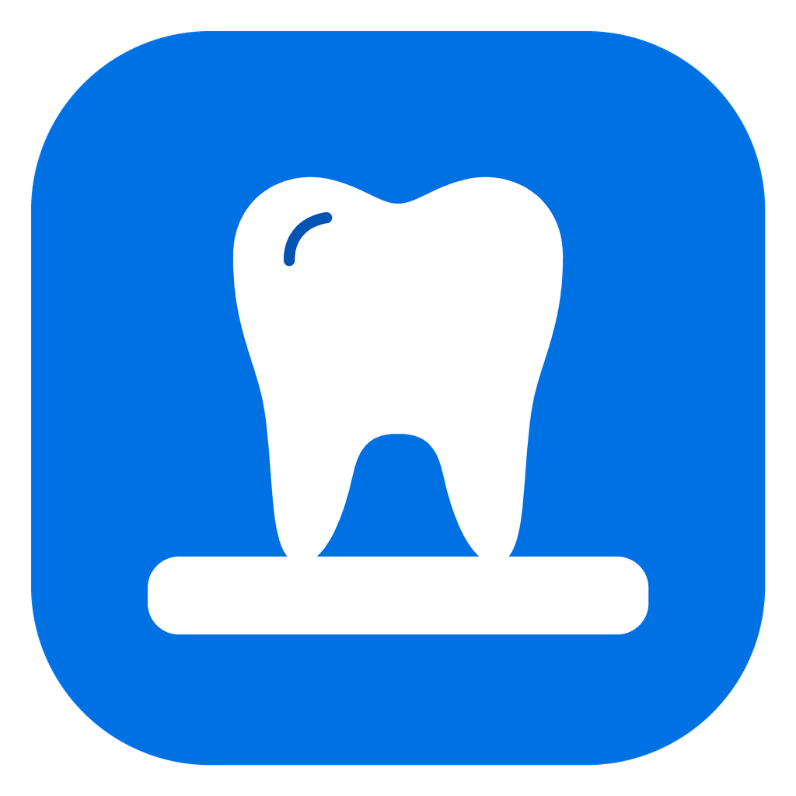
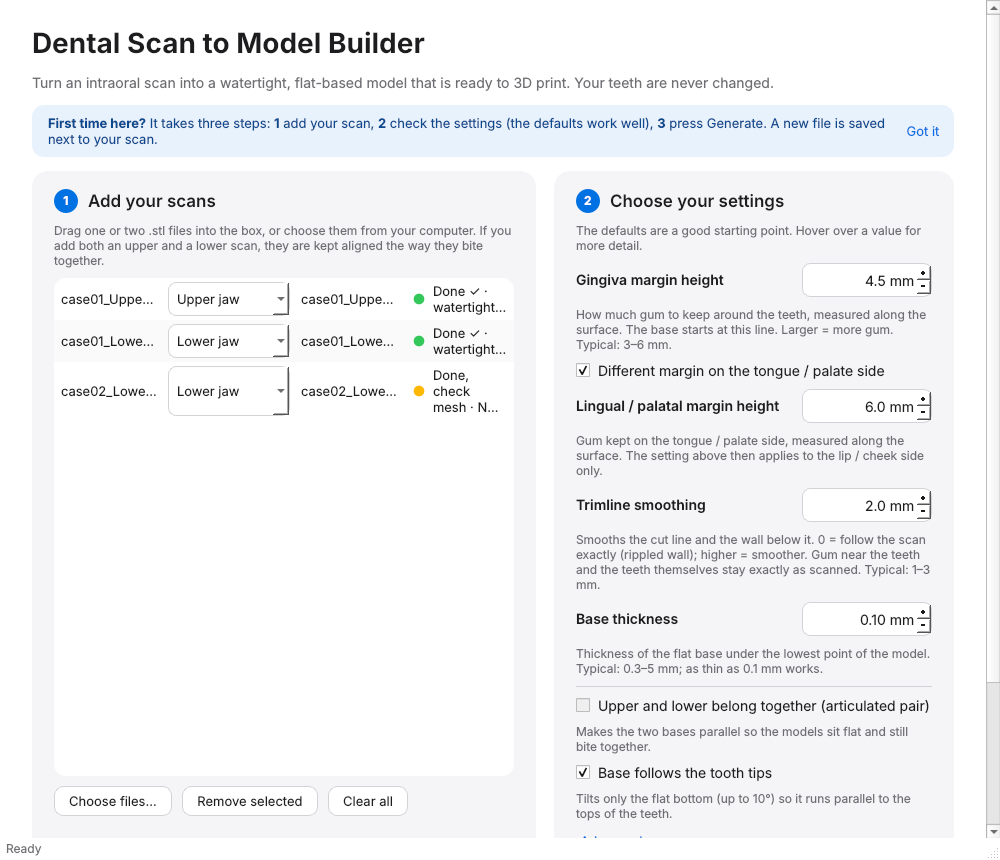

<div align="center">



# Dental Scan to Model Builder

**Turn a raw intraoral scan into a watertight, flat-based dental model that is ready to 3D print.**

Drag in an STL → press **Generate** → get a printable model next to your scan.<br>
Pure geometry. **No machine learning, no GPU, no downloads of model weights.** Runs offline on your own computer.

</div>

<p align="center"></p>

---

## Contents

[What it does](#what-it-does) · [Get the app](#get-the-app) · [How to use it](#how-to-use-it) · [What you get](#what-you-get) · [Our promises](#our-promises) · [Settings](#settings) · [Command line](#command-line) · [How it works](#how-it-works) · [Limitations](#known-limitations) · [Build it yourself](#build-it-yourself) · [Repository map](#repository-map)

---

## What it does

An intraoral scanner gives you a surface: teeth and gum with a ragged, open edge. To 3D print a study model you need a
solid with a clean cut and a flat bottom. This app does that for you:

```
   raw scan (open, ragged)          cut at the gum line             printable model
  ┌───────────────────────┐      ┌───────────────────────┐      ┌───────────────────────┐
  │  teeth + gum, torn    │  →   │  teeth + a neat band  │  →   │  teeth + band + wall  │
  │  edges, no bottom     │      │  of gum, smooth edge  │      │  + flat base (solid)  │
  └───────────────────────┘      └───────────────────────┘      └───────────────────────┘
```

It works with a **single arch** or an **upper + lower pair** that were scanned in the same bite. For a pair, the
models keep their exact position relative to each other, so they still fit together.

**Who is it for?** Dental labs, clinics and anyone who prints models from intraoral scans and is tired of fixing
meshes by hand.

---

## Get the app

Download the zip for your computer from the **Releases** page of this repository (or from **Actions → Build apps → Artifacts**), unzip it and open it. No Python needed.

| Download | For |
|---|---|
| `DentalScanToModelBuilder-macOS-AppleSilicon.zip` | Macs with an M1 / M2 / M3 / M4 chip |
| `DentalScanToModelBuilder-macOS-Intel.zip` | older Intel Macs |
| `DentalScanToModelBuilder-Windows.zip` | Windows 10 / 11 (run `DentalScanToModelBuilder.exe`) |

> **First launch:** the app is not code-signed yet, so your system will ask once.
> - **macOS:** right-click the app → **Open** → **Open**. (If it still refuses: *System Settings → Privacy & Security → Open Anyway*.)
> - **Windows:** *Windows protected your PC* → **More info → Run anyway**.
>
> The app is large (about 400–700 MB unzipped) because it contains Python and every library it needs.

Prefer to run from source? See [Run from source](#run-from-source).

---

## How to use it

1. **Add your scans.** Drop one or two binary `.stl` files into the box (or press *Choose files…*). The jaw (upper / lower) is guessed from the file name; change it if needed.
2. **Check the settings.** The defaults work well for most scans. Hover over a setting to see what it does.
3. **Press Generate.** A progress panel shows each step. Results are saved **next to your scan** as `<name>_output.stl`.

Each file gets a coloured status dot:

| Dot | Meaning |
|---|---|
| ⚪ grey | Ready or waiting in the queue |
| 🔵 blue | Running now |
| 🟢 green | **Done**: watertight, one solid piece, teeth exactly as scanned |
| 🟡 yellow | **Done, but check the mesh**: not watertight, or has tunnels (see [limitations](#known-limitations)) |
| 🔴 red | **Failed**: the message says why. This includes the case where the teeth would differ from your scan: such a file is flagged *do not use* |
| ⚫ dark grey | Cancelled |

> Only **binary** STL files are accepted (the usual output of scanner software). Scans are assumed to be in **millimetres**.

---

## What you get

- A single `…_output.stl` per scan: teeth, a band of gum, a smooth vertical wall and a flat base.
- A one-line result in the app (and a full report in the log) telling you if the model is a closed solid.
- Upper and lower outputs that still sit in the original bite position.

---

## Our promises

These are checked automatically after every export, by reloading the file that was written.

| Promise | How it is verified |
|---|---|
| **Teeth are never changed.** Crown vertices (plus a small ring around them) are copied bit-for-bit from your scan: not smoothed, moved, remeshed or cut. | The report shows `crown_exact_pct` (should be **100.0**) and `crown_max_dev_mm` (should be **0.0**). |
| **The bite is preserved.** Outputs are written in the scan's own coordinate system, so a registered upper and lower still fit together. | The gap between the arches is identical before and after. |
| **Only the cut edge is touched.** Besides the cut, only a narrow strip along it (about 1 mm at most) is blended; everything farther away is bit-exact. | Same exactness check. |

---

## Settings

| Setting (GUI) | Command line | Default | What it does |
|---|---|---|---|
| Gingiva margin height | `--offset` | 4.5 mm | How much gum to keep around the teeth (distance along the surface). The base starts at this line. |
| Trimline smoothing | `--loop-sigma` | 1.5 mm | Smooths the cut line and the wall below it. 0 = follow the scan exactly (rippled wall). |
| Base thickness | `--thickness` | 0.5 mm | Thickness of the flat base under the lowest point of the model. |
| Articulated pair | `--pair` | off | Process an upper and lower scan together so both bases are parallel to the shared bite plane. |
| Base follows the tooth tips | `--follow-tips` | off | Tilts the flat bottom (up to 10°) so it runs parallel to the incisal edges and cusp tips instead of the estimated bite plane. In a pair, each jaw follows its own tips. If the tip plane is more than 10° away, the normal plane is used. |
| Blend width (Advanced) | `--strip` | auto | Width of the strip along the cut edge where the scan follows the smoothed line. |

More options (`--smooth`, `--trim-mode`, `--preview`) are listed under [Command line](#command-line).

---

## Command line

Everything the app does is also available as a command, which is handy for batches.

```bash
# one scan → one model
python make_base.py upper_scan.stl upper_model.stl

# articulated upper + lower pair (shared bite plane, original coordinates kept)
python make_base.py --pair upper_scan.stl lower_scan.stl --outdir out --offset 4

# flat base parallel to the tooth tips
python make_base.py lower_scan.stl lower_model.stl --follow-tips

# a different margin height, plus a PNG preview
python make_base.py lower_scan.stl lower_model.stl --offset 3 --preview

# batch: many scans × several margin heights → out/<name>_base_o<offset>.stl
python make_base.py scans/*.stl --outdir out --offset 2 4 6

# independent printability check of any exported STL
python verify.py upper_model.stl
```

<details>
<summary><b>All options</b></summary>

| Option | Default | Meaning |
|---|---|---|
| `--offset` | 4.5 | gingiva margin height in mm (several values allowed in batch mode) |
| `--smooth` | 6.0 | advanced: smoothing of the trim field before the cut; barely changes the wall |
| `--loop-sigma` | 1.5 | trimline smoothing in mm (3D outline and height); the wall is extruded straight down from it |
| `--strip` | auto | advanced: blend width of the fade strip along the cut edge (≈1 mm where the edge moves noticeably, narrower where it barely moves) |
| `--thickness` | 0.5 | base thickness below the lowest scan point, mm |
| `--follow-tips` | off | base parallel to the tooth tips (limit 10°) |
| `--trim-mode` | base | `base`: smooth wall, scan altered only in the edge strip. `deform`: legacy mode that also blends the smoothing into the surface within ~5 mm of the trimline |
| `--preview` | off | write a PNG render next to each output |
| `--pair A B` / `--pair-out A B` | | articulated pair; explicit output paths |

A typical run takes about 15–20 s per scan (200–270 k triangles) on a 2-core CPU and a few GB of RAM.
</details>

**Reading the result.** The command prints a JSON report. `watertight: true` and `euler: 2` mean a simple closed solid.
`verify.py` also reports the genus (0 = no tunnels) and cross-checks the mesh with a second geometry kernel.

---

## How it works

No trained model is involved, only geometry:

| # | Step | Idea |
|---|---|---|
| 1 | **Read & clean** | Merge duplicate vertices, drop tiny floating fragments. |
| 2 | **Find the bite plane** | Estimate the occlusal direction from the cusp tips and orient the mesh (internally only; the output returns to the original coordinates). |
| 3 | **Find the teeth** | A random-walker field over the surface, with edge weights cut at concave creases (curvature barriers). It is seeded by cusp tips (teeth) and the scan border (gum). Seeds ignore the ragged scan border and spiky triangles so they cannot be mistaken for teeth. |
| 4 | **Draw the trimline** | A line at a set distance along the surface from the crowns (the *gingiva margin height*). If the kept region splits (gaps in the arch), the pieces are bridged so the model stays one continuous horseshoe. |
| 5 | **Cut & smooth** | Cut the scan there, close tiny holes using only existing vertices, then smooth the cut line and blend it into the scan inside a narrow strip. |
| 6 | **Build the base** | Extrude the line as a wall down to a flat plane (parallel to the bite plane, or to the tooth tips if requested) and cap it with an evenly meshed floor. |
| 7 | **Save & check** | Write a binary STL back in the scan's own coordinates, then reload it to verify watertightness and that the teeth are exact. |

**Using it from Python:**

```python
from dentalbase.pipeline import make_base
make_base('in.stl', 'out.stl', offset=4.0)
```

---

## Known limitations

Please read before relying on it.

- **Small self-intersections can remain on some scans**, typically near the back ends of the arch where gum curls below the cut. Tooth surfaces are unaffected, but a slicer may need to repair those spots. Smoothing above ~3–4 mm can add more.
- **Tunnels (handles) that are already in the raw scan are not removed.** The result is still watertight, but its `euler` number is not 2, and the app marks it yellow.
- **The input must be a single-arch scan with one open border** (the usual cropped intraoral scan). Binary STL only.
- **Validated on a limited number of scans.** The margin line has not been measured against hand-labelled ground truth, so check every result before printing.
- **The flat base sits below the lowest scan point**, so arches with tall back ends get tall back blocks. *Base follows the tooth tips* can help when the bottom looks tilted.
- Optional self-intersection check: `pip install pymeshlab` (Linux also needs `apt install libopengl0`); `verify.py` uses it when present.

---

## Build it yourself

### Run from source

Needs Python 3.10 or newer (developed on 3.13).

```bash
python3 -m venv .venv
source .venv/bin/activate              # Windows: .venv\Scripts\activate
pip install -r requirements-gui.txt    # backend libraries + PySide6 for the window
python gui.py                          # open the app
```

Command line only: `pip install -r requirements.txt`. Everything installs from PyPI as ready-made wheels; if `libigl` or `potpourri3d` has no wheel for your Python, try Python 3.11–3.13.

### Make the double-click app

**On GitHub (no setup):** *Actions → Build apps → Run workflow* builds macOS (Apple Silicon and Intel) and Windows. Push a tag like `v1.0.0` to attach the zips to a Release.

**On your own computer:**

```bash
python -m pip install -r requirements-gui.txt pyinstaller
python packaging/make_icon.py
python -m PyInstaller packaging/DentalScanToModelBuilder.spec --noconfirm   # result in dist/
```

The packaged app runs its processing by starting itself with `--run-backend`; `--selftest` checks that every library loaded.

### Run the tests

```bash
python -m pytest -q tests
```

---

## Repository map

```
make_base.py                 command-line tool (also what the app runs behind the scenes)
verify.py                    independent printability checks
gui.py                       starts the desktop app
dentalbase/                  the engine (no GUI code)
    pipeline.py                  end-to-end flow, tooth finding, island bridging
    dbase.py                     geometry building blocks (curvature, geodesics, cut, smoothing, base)
    render.py                    optional PNG previews
dentalbase_gui/              the window (PySide6); talks to the engine only through make_base.py
packaging/                   app icon, PyInstaller spec, build workflow copy
tests/                       automated tests
docs/                        screenshots
.github/workflows/           GitHub build of the downloadable apps
```

The window and the engine are deliberately separate: the app never imports the engine, it runs `make_base.py` as a
separate process (so a job can be cancelled) and reads its output. Either side can change as long as the command line stays the same.

---

## Licence

Free for **noncommercial use** under the [PolyForm Noncommercial License 1.0.0](LICENSE). Personal, research, educational and
non-profit use is welcome. Commercial use (selling it or using it in a paid product or service) needs separate permission:
please contact the author.

The graded base is built with [Triangle](https://www.cs.cmu.edu/~quake/triangle.html), which itself restricts commercial use.
Other libraries and their licences are listed in [THIRD_PARTY_LICENSES.md](THIRD_PARTY_LICENSES.md).

<p align="center"><sub>© 2026 Elias Prountzos</sub></p>
